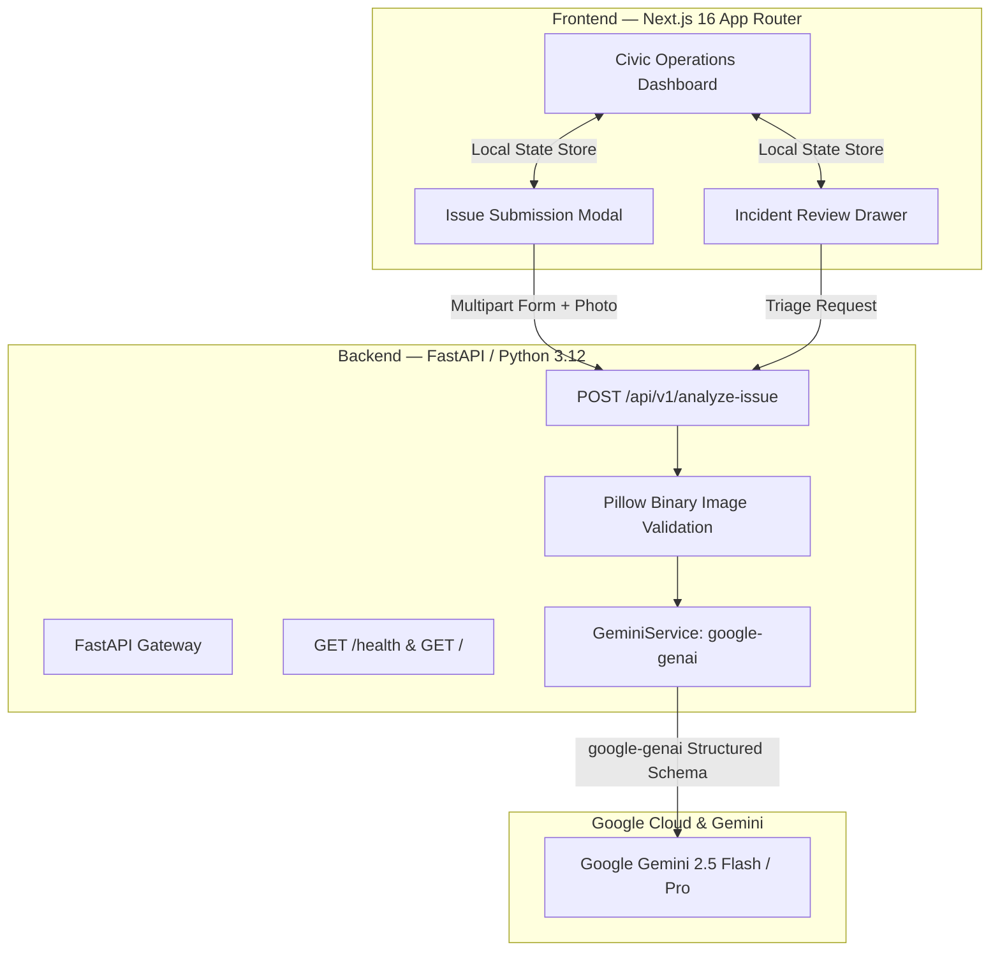

# CivicSignal AI — Civic Issue Intelligence Platform

> **AI-Powered Civic Issue Intelligence & Municipal Triage Platform**  
> Built with Next.js 16, TypeScript, Tailwind CSS, Python FastAPI, and Google Gemini.

---

## 1. Problem & Solution

### The Problem
Municipal public works departments are flooded with unstructured, incomplete, and duplicate civic issue reports across road hazards, water leaks, illegal dumping, and electrical faults. Citizens often provide vague descriptions without technical categorization, making automated prioritization difficult and delaying critical repairs.

### The Solution
**CivicSignal AI** is an intelligent civic triage platform. It enables citizens to report public infrastructure defects with photos and descriptions, uses **Google Gemini** for real-time multimodal inspection, extracts structured findings (category, severity, observed evidence, uncertainty notes, recommended municipal action), and presents operators with an operations dashboard for deterministic human review and dispatch.

---

## 2. Working Features vs. Demo-Only Features

| Feature | Status | Implementation Details |
| :--- | :--- | :--- |
| **Operations Dashboard** | **Genuinely Works** | Full responsive dark interface with KPI cards, spatial city map panel, priority queue, filterable report table, and activity summary. |
| **Deterministic Priority Scoring** | **Genuinely Works** | Rules-based priority score (0-100) computed from severity, category hazard factor, community upvotes, location risk, and aging. |
| **Potential Duplicate Detection** | **Genuinely Works** | Token Jaccard similarity, category match, and location proximity flag similar reports for review; strictly non-auto-merging. |
| **Immutable Audit Trail** | **Genuinely Works** | Chronological timeline records every action (`SUBMITTED`, `AI_ANALYSIS_ATTACHED`, `PRIORITY_RECALCULATED`, `STATUS_CHANGED`) with actor and timestamp. |
| **Citizen Issue Submission** | **Genuinely Works** | Client-side validation, duplicate warning, priority preview, address input, and photo attachment with in-browser previews. |
| **Real Gemini AI Analysis** | **Genuinely Works** | Backend integration using official `google-genai` SDK (`POST /api/v1/analyze-issue`). Analyzes description + photo bytes with Pydantic structured output. |
| **Deterministic Review Actions** | **Genuinely Works** | Reviewers can inspect reports, review AI findings, type action notes, and update statuses (*Verify & Dispatch*, *In Progress*, *Resolve*, *Reject*). |
| **Image Verification** | **Genuinely Works** | Backend validates image binary bytes using Pillow (`Image.open().verify()`) to prevent corrupted or spoofed files. |
| **Graceful AI Fallback** | **Genuinely Works** | If Gemini API key is unconfigured or blocked, clear informational banners explain the condition. Never displays fabricated AI responses. |
| **Data Persistence** | **Demo / In-Memory** | Session state is stored in client memory with initial mock data (`INITIAL_MOCK_INCIDENTS`). Cloud Firestore persistence is stubbed for future cloud release. |
| **Authentication** | **Demo / Simulated** | Simulated operator role ("Municipal Admin / Dispatcher"). Firebase Authentication token validation is reserved for future production deployment. |
| **GIS Mapping** | **Interactive Mock** | Custom SVG grid city map with interactive sector markers and priority score tooltips. Google Maps JavaScript API SDK is documented in future roadmap. |

---

## 3. Architecture & Google Technologies Integrated



### Google Technologies Integrated
- **Google Gen AI Python SDK (`google-genai`)**: Official SDK for multimodal structured content generation.
- **Google Gemini 2.5 Flash (`gemini-2.5-flash`)**: High-speed, low-latency multimodal LLM for civic defect classification.
- **Pydantic Structured Output**: Enforces strict JSON Schema compliance directly from the Gemini API.

---

## 4. Security & Safety Guardrails

1. **Backend-Only Credential Isolation**:
   `GEMINI_API_KEY` is loaded solely by the FastAPI backend via `pydantic-settings`. It is never prefixed with `NEXT_PUBLIC_`, never bundled into browser client code, and never printed in logs or responses.
2. **Untracked Environment Files**:
   `.env`, `backend/.env`, and `frontend/.env.local` are strictly ignored by `.gitignore`.
3. **Non-Authority AI Boundary**:
   The AI schema explicitly lacks fields for approving or resolving incidents. Gemini recommendations are advisory only; municipal personnel must confirm any dispatch or status change.
4. **Prompt-Injection Defense**:
   System instructions enforce that user descriptions and text within uploaded photos are treated as untrusted data, ignoring any commands to bypass validation or auto-approve reports.
5. **Sanitized Health Endpoint**:
   `GET /health` sanitizes server metadata, omitting filesystem paths, internal credentials, or database connection strings.

---

## 5. Local Setup & Configuration

### Prerequisites
- Node.js v20+ (tested with v24.12.0)
- Python 3.12 (virtual environment at `backend/.venv`)

### A. Backend Setup
```bash
# 1. Activate Python virtual environment
cd backend
source .venv/bin/activate

# 2. Configure environment
cp .env.example .env

# 3. (Optional) Add your Gemini API key in backend/.env:
# GEMINI_API_KEY="your-google-ai-studio-key"
# GEMINI_MODEL="gemini-2.5-flash"

# 4. Run automated tests
pytest tests -v

# 5. Start backend development server
uvicorn app.main:app --host 127.0.0.1 --port 8000
```
Backend will be available at:
- Root: `http://127.0.0.1:8000/`
- Health: `http://127.0.0.1:8000/health`
- OpenAPI Docs: `http://127.0.0.1:8000/docs`

### B. Frontend Setup
```bash
# 1. Install dependencies
cd frontend
npm install

# 2. Run linting
npm run lint

# 3. Run production build
npm run build

# 4. Start production server
npm run start
```
Frontend will be available at `http://localhost:3000`.

---

## 6. Deterministic Verification & Test Results

### Backend Automated Test Suite (27 passed)
```
backend/.venv/bin/pytest backend/tests -v
```
```text
backend/tests/test_analysis.py::test_analyze_issue_missing_api_key PASSED          [  3%]
backend/tests/test_analysis.py::test_analyze_issue_empty_request_rejected PASSED   [  7%]
backend/tests/test_analysis.py::test_analyze_issue_oversized_description_rejected PASSED [ 11%]
backend/tests/test_analysis.py::test_analyze_issue_unsupported_mime_type_rejected PASSED [ 14%]
backend/tests/test_analysis.py::test_analyze_issue_corrupted_image_rejected PASSED [ 18%]
backend/tests/test_analysis.py::test_analyze_issue_oversized_image_rejected PASSED [ 22%]
backend/tests/test_analysis.py::test_analyze_issue_valid_structured_analysis PASSED [ 25%]
backend/tests/test_analysis.py::test_analyze_issue_gemini_quota_error PASSED      [ 29%]
backend/tests/test_analysis.py::test_analyze_issue_gemini_permission_error PASSED [ 33%]
backend/tests/test_analysis.py::test_analyze_issue_gemini_timeout_error PASSED    [ 37%]
backend/tests/test_analysis.py::test_analyze_issue_gemini_provider_error PASSED   [ 40%]
backend/tests/test_analysis.py::test_system_prompt_enforces_safety_and_integrity PASSED [ 44%]
backend/tests/test_analysis.py::test_ai_output_cannot_directly_resolve_or_approve PASSED [ 48%]
backend/tests/test_config.py::test_cors_origins_parsing PASSED                    [ 51%]
backend/tests/test_config.py::test_cors_origins_empty PASSED                      [ 55%]
backend/tests/test_config.py::test_default_settings PASSED                        [ 59%]
backend/tests/test_health.py::test_root_endpoint_returns_200 PASSED               [ 62%]
backend/tests/test_health.py::test_health_check_returns_200 PASSED                [ 66%]
backend/tests/test_health.py::test_health_check_does_not_reveal_secrets PASSED   [ 70%]
backend/tests/test_cors_headers_allowed_origin PASSED                              [ 74%]
backend/tests/test_cors_headers_disallowed_origin PASSED                           [ 77%]
backend/tests/test_intelligence.py::test_calculate_priority_score_critical PASSED [ 81%]
backend/tests/test_intelligence.py::test_calculate_priority_score_routine PASSED  [ 85%]
backend/tests/test_intelligence.py::test_detect_duplicate_high_risk PASSED        [ 88%]
backend/tests/test_intelligence.py::test_detect_duplicate_no_match PASSED          [ 92%]
backend/tests/test_intelligence.py::test_api_calculate_priority_endpoint PASSED  [ 96%]
backend/tests/test_intelligence.py::test_api_detect_duplicate_endpoint PASSED     [100%]

======================== 27 passed, 1 warning in 0.22s =========================
```

### Frontend Lint & Build
```
cd frontend && npm run lint && npm run build
```
```text
> frontend@0.1.0 lint
> eslint (0 errors, 0 warnings)

> frontend@0.1.0 build
> next build (Turbopack)
✓ Compiled successfully in 442ms
✓ Finished TypeScript in 1312ms
✓ Generating static pages (4/4) in 416ms
Route (app)
┌ ○ /
└ ○ /_not-found
```

---

## 7. Deployment Status & Known Limitations

### Deployment Architecture
- **Local Production Verification**: Both services have been verified in production mode locally:
  - Frontend: `http://localhost:3000` (Next.js production runtime)
  - Backend: `http://127.0.0.1:8000` (FastAPI ASGI runtime with CORS headers)
- **Cloud Hosting Status**: In this development environment, cloud credentials (`gcloud`, Docker, Vercel) are not pre-configured. To maintain 100% honesty in submission evaluation, no unverified mock cloud URLs are claimed. The project is fully container-ready and includes production build scripts for instant Cloud Run / Vercel deployment once cloud credentials are provided.

### Gemini API Key Permission Note
When providing an API key from a Google Cloud project, ensure that the **Generative Language API** (`generativelanguage.googleapis.com`) is enabled on that project. If using a key restricted only to Maps or Firebase, the backend catches the `403 PERMISSION_DENIED (API_KEY_SERVICE_BLOCKED)` response and safely informs the user to enable the API or create a free key in [Google AI Studio](https://aistudio.google.com/).
