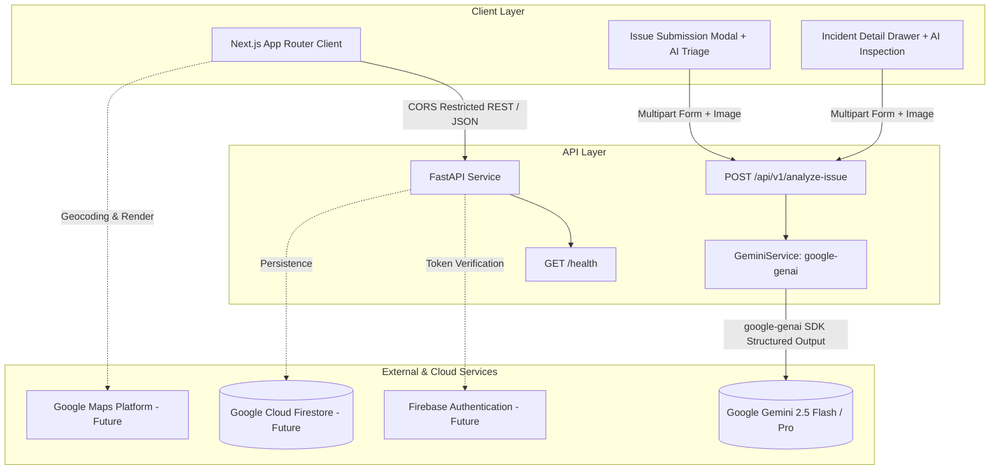

# CivicSignal AI — System Architecture Overview

## 1. System Vision

CivicSignal AI is an intelligent civic issue platform engineered for a competitive application development competition. It bridges the gap between citizens reporting public infrastructure anomalies (e.g., potholes, utility failures, streetlight hazards) and municipal departments dispatching repairs.

The platform architecture centers around two primary services:
1. **Frontend Client**: Next.js App Router providing responsive citizen reporting, real-time spatial mapping, and administrative analytics.
2. **Backend API**: Python FastAPI handling authentication validation, data persistence, and Gemini-powered triage orchestration.



---

## 2. Component Directory Architecture

```
comp/
├── .github/
│   └── workflows/
│       └── ci.yml               # GitHub Actions for frontend lint/build & backend tests
├── backend/
│   ├── app/
│   │   ├── api/
│   │   │   └── routes/
│   │   │       └── health.py    # GET /health endpoint
│   │   ├── schemas/
│   │   │   └── health.py        # Pydantic schema for health response
│   │   ├── config.py            # Pydantic BaseSettings & CORS management
│   │   └── main.py              # FastAPI app factory & lifecycle
│   ├── tests/
│   │   ├── conftest.py          # Pytest fixtures and TestClient
│   │   ├── test_config.py       # Configuration and CORS parsing tests
│   │   └── test_health.py       # Health check, CORS, and secret exclusion tests
│   ├── .env.example             # Safe template for backend environment variables
│   ├── pyproject.toml           # Pytest & package definitions
│   ├── requirements.txt         # Production dependencies
│   └── requirements-dev.txt     # Development and testing dependencies
├── frontend/
│   ├── src/
│   │   └── app/
│   │       ├── layout.tsx       # Root Next.js layout & typography
│   │       ├── page.tsx         # CivicSignal AI Phase 0 landing page
│   │       └── globals.css      # Tailwind CSS imports
│   ├── public/                  # Static assets
│   ├── .env.example             # Safe template for frontend environment variables
│   ├── next.config.ts           # Next.js build configuration
│   ├── package.json             # NPM package scripts & dependencies
│   └── tsconfig.json            # Strict TypeScript configuration
├── docs/
│   ├── architecture/
│   │   └── overview.md          # Architecture overview (this document)
│   ├── setup.md                 # Setup and run instructions
│   ├── prompt.md                # Harness engineering master prompt
│   ├── raw.md                   # Problem statement
│   └── harness.md               # Harness engineering specification
├── evaluation/
│   └── README.md                # Reserved directory for dataset benchmarks & evaluations
├── .gitignore                   # Strict multi-layer ignore rules
├── .env.example                 # Root environment blueprint
└── README.md                    # Root project documentation
```

---

## 3. Security & Boundary Guardrails

1. **Zero Secret Leakage**:
   - No API keys, credentials, or service account JSON files are committed to Git.
   - The `GET /health` endpoint specifically sanitizes all output, returning only service status, version, and server timestamp. It intentionally excludes environment dumps, path information, or database credentials.

2. **CORS Isolation**:
   - Unrestricted wildcard (`"*"`) CORS is disabled in production. Allowed origins are driven exclusively by `ALLOWED_ORIGINS` in `.env`.

3. **Runtime Stability**:
   - Backend utilizes Python 3.12 (via `/Users/pushkarganeshshinde/.local/bin/python3.12`) rather than experimental Python 3.14 to guarantee binary wheel compatibility across Google Cloud libraries, Pydantic, and ASGI servers.
